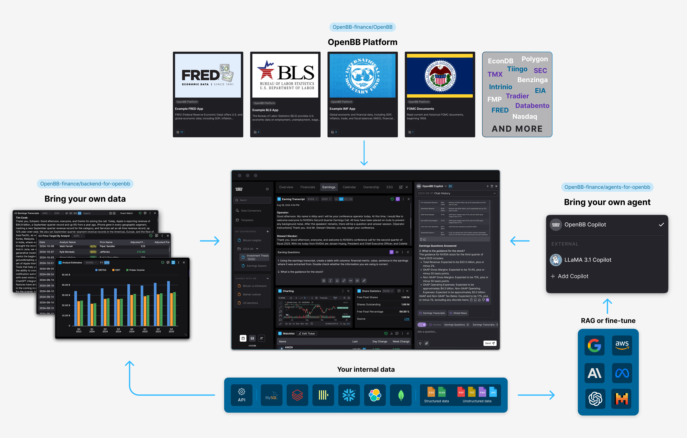
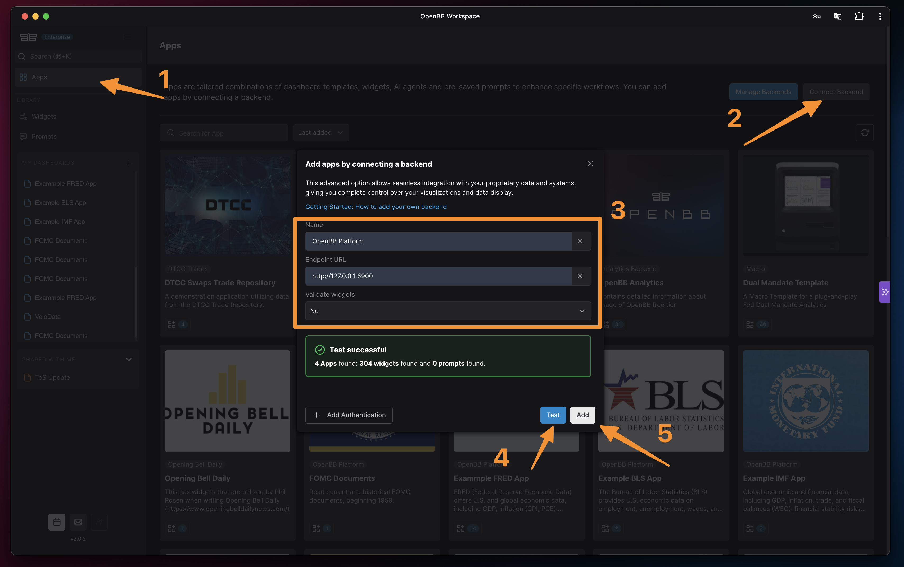
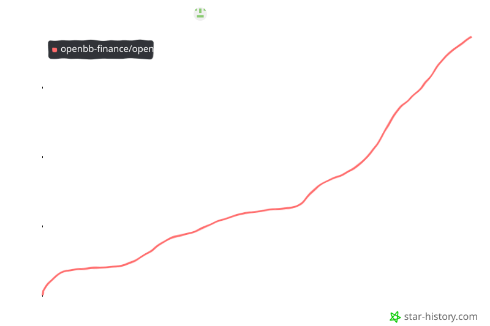

# OpenBB Finance: Professional Quantitative Research Toolkit — Web Platform

  

---

OpenBB-finance is the leading open-source investment-research platform, engineered as a professional quantitative-analysis toolkit for stocks, crypto, forex, and beyond. It unifies multi-asset market data, portfolio analytics, and strategy simulation inside a single extensible environment built for serious research workflows. Analysts, quants, and developers can move from raw data to validated insight without stitching together fragmented tools. Whether you are prototyping an algorithmic strategy or stress-testing a portfolio, OpenBB-finance delivers institutional-grade capability with the transparency of open source.

## Features

OpenBB-finance delivers a complete, open-source investment-research environment built for analysts, quants, and developers who need professional-grade insight without vendor lock-in. Every capability is unified beneath a single, coherent interface—so moving from a market question to a data-backed answer feels effortless.

- **True multi-asset coverage** — Research equities, options, cryptocurrencies, forex, macro indicators, and fixed income from one consistent toolkit. No context-switching between disconnected tools or incompatible data models.
- **A professional quantitative-analysis toolkit** — Run screening, historical analysis, and comparative research with a workflow designed around how real investment research gets done, not around how databases happen to be structured.
- **One unified interface** — Every dataset and function is exposed through a single, predictable surface, whether you prefer a programmatic Python workflow or a command-line experience. Learn it once, apply it everywhere.
- **Extensible by design** — A broad range of extensions lets you tailor the platform to your own data sources, analytics, and workflows, so the toolkit grows with your research instead of capping it.
- **Dataframe-native output** — Results arrive in familiar, analysis-ready structures that drop straight into your existing quantitative pipelines, notebooks, and models.
- **Multi-exchange and multi-vendor reach** — Aggregate market data across venues and providers into one normalized view, simplifying validation and cross-market comparison.
- **Built for the full research lifecycle** — From market-data validation and strategy simulation to portfolio management and execution-oriented infrastructure, the platform supports the entire arc of quantitative work.
- **Open source at its core** — Transparent, auditable, and community-driven. Inspect every layer, adapt it to your needs, and contribute back to a platform shaped by its users.

OpenBB-finance is more than a library—it is the foundation for a modern, open investment-research practice.

## Tech Stack

OpenBB-finance is engineered as a modern, modular investment-research platform where every layer is chosen to keep analysis fast, extensible, and production-ready. The stack pairs a Python-first analytical core with a responsive web application layer, so quantitative workflows and interactive research live in one coherent environment.

**Analytical Core — Python**
At the heart of the platform sits a Python engine built for quantitative analysis across stocks, crypto, forex, and more. It handles data ingestion, normalization, and computation with the maturity expected of a professional research toolkit, while remaining approachable for analysts who prefer to work close to the data.

**Web Application Layer — Modern JavaScript Frontend**
The user-facing experience is delivered through a contemporary JavaScript frontend framework, giving the platform a polished, responsive interface for exploring datasets, building views, and navigating multi-asset research without friction.

**API & Service Layer — FastAPI**
A FastAPI-powered service layer exposes the platform's capabilities cleanly and efficiently. It provides the connective tissue between the analytical engine and the interface, supporting high-throughput data access and a developer-friendly contract for extending the platform.

**Data Integration Architecture**
OpenBB-finance is designed around pluggable data integrations, allowing dozens of sources to coexist behind a unified interface. This abstraction keeps the platform vendor-agnostic and lets teams swap, extend, or add providers without disrupting existing workflows.

**Extensibility by Design**
The stack is intentionally modular: extensions, custom data providers, and additional analytical capabilities can be layered on top of the core without forking the platform. This keeps the toolkit adaptable as research needs and market coverage grow.

**Built for Real-World Research**
From rapid prototyping to repeatable analysis pipelines, the technology choices prioritize performance, clarity, and long-term maintainability — the same qualities that make OpenBB-finance a dependable foundation for professional investment research.

## Getting Started

OpenBB-finance is built for analysts and quants who want institutional-grade research tooling without proprietary lock-in. It brings stocks, crypto, forex, and more into one coherent quantitative-analysis toolkit, so you can spend less time stitching together data sources and more time generating insight.

The platform is designed around a few core principles:

- **Multi-asset by default.** Research equities, crypto, forex, and adjacent markets through a single consistent interface.
- **Extensible at every layer.** Add data providers, custom analytics, or entirely new workflows through the extension system.
- **Developer-first.** A Python-native experience that fits cleanly into notebooks, research scripts, and production pipelines.
- **Open and transparent.** As a leading open-source investment-research platform, the codebase is yours to inspect, adapt, and build upon.

### Your first steps

The fastest path from zero to a working dataset is to explore the toolkit interactively, then graduate to structured projects as your needs grow. A typical first session looks like this:

1. **Orient yourself with the feature set.** Skim the feature overview to understand what's available across asset classes and analytics modules.
2. **Run an example workflow.** Load a sample query, inspect the returned data structure, and convert results into a familiar dataframe for downstream analysis.
3. **Connect your preferred data providers.** The extension model lets you plug in additional sources without rewriting your research code.
4. **Build a research routine.** Combine price data, fundamentals, and portfolio tools into a repeatable script or notebook.

### Who it's for

OpenBB-finance fits a wide range of workflows: portfolio managers validating ideas, developers building analytics products, educators teaching quantitative methods, and researchers who need a dependable foundation for market analysis. If you're comfortable with Python, you'll feel at home quickly.

### Where to go next

Once you've run your first query, the natural next steps are exploring the feature reference, examining the tech stack to understand how components fit together, and reviewing the FAQ for common questions. From there, the toolkit is yours to shape.

## 📸 Screenshot

## FAQ

**Is OpenBB-finance really free to use?**
Yes. OpenBB-finance is fully open source, so you can inspect the code, self-host the platform, and build on top of it without licensing fees. It's designed to give individual analysts and teams the same caliber of research tooling that was previously locked behind expensive terminals.

**Which asset classes are supported?**
The platform covers equities, options, crypto, forex, macroeconomy, fixed income, and more — all through a single, consistent interface. Whether you're screening stocks, tracking digital assets, or monitoring macro indicators, the toolkit is built to handle multi-asset research workflows without switching between disconnected tools.

**Do I need to be a developer to use it?**
Not necessarily, but OpenBB-finance is built for people who are comfortable working with data. The platform exposes a clean, Pythonic API for programmatic access, making it a natural fit for quants, analysts, and data scientists. If you prefer working in code or notebooks, you'll feel right at home.

**Can I extend the platform with my own data sources or tools?**
Absolutely. OpenBB-finance is architected around extensibility, so you can plug in additional data providers, custom analytics, or proprietary datasets. The open-source nature means there's no black box — you control how the platform grows with your research needs.

**Is the data reliable enough for professional research?**
The platform aggregates data from a broad range of providers and is built with market-data validation in mind. As with any research tool, we recommend cross-referencing critical figures against your primary sources — but the infrastructure is designed to support serious, professional-grade analysis.

**Who is OpenBB-finance built for?**
Quants, investment researchers, fintech developers, and anyone who wants a professional-grade quantitative analysis toolkit without vendor lock-in. From portfolio management and strategy simulation to multi-exchange data access, it's a foundation for building the research stack you actually want.

**How actively is the project maintained?**
OpenBB-finance is backed by an active open-source community and a steady cadence of improvements. Contributions, bug reports, and feature requests are welcome — the project thrives on collaboration from users who care about open financial tooling.

**Where can I learn more or get help?**
Start with the documentation to explore features and workflows in depth. For questions, feedback, or partnership inquiries, reach out through the project's official channels — the team is responsive and genuinely invested in helping users get the most out of the platform.

## License

OpenBB-finance is released under the MIT License, giving you the freedom to use, modify, and distribute the platform with minimal restrictions. Whether you're building a personal research workflow, embedding the toolkit into a commercial product, or extending it for your team's proprietary strategies, the license is designed to stay out of your way and let the technology work for you.

The full license text ships with the project, so you can review the exact terms at your convenience before integrating OpenBB-finance into your stack. Permissive by design, it reflects our commitment to keeping professional-grade investment research open, accessible, and adaptable for developers and analysts at every level.

